

<picture>
  <source media="(prefers-color-scheme: dark)" srcset="assets/melo_icon.png">
  <source media="(prefers-color-scheme: light)" srcset="assets/melo_icon.png">
  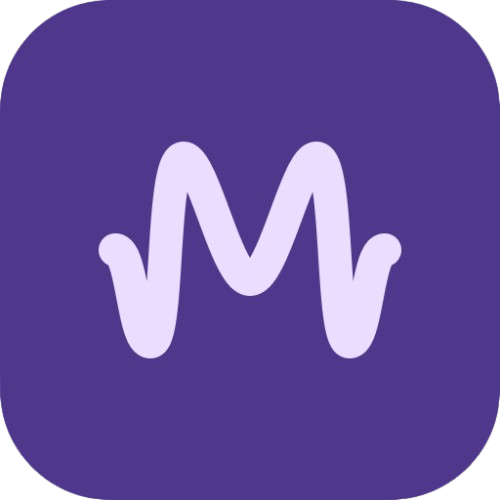
</picture>

# Melo

**Tu música, tu Melo.**

🎵 Reproductor de música **local** para Android, con **Material 3 Expressive**, español completo y optimizaciones para gama baja.

 

### [🌐 Web](https://melo-player-ten.vercel.app/) • [📥 Descargar](https://github.com/angel-ssk/Melo/releases/latest) • [📖 Wiki](https://github.com/angel-ssk/Melo/wiki)

---

## ✨ Qué es Melo

Melo es un reproductor de música **local**: lee tu biblioteca del dispositivo y no depende de servicios de streaming. Prioriza una identidad visual propia, el rendimiento en móviles modestos y una experiencia en español completa.

| 🎨 **Diseño** | 🎵 **Reproducción** |
| :--- | :--- |
| **Melo Wave:** paleta morada derivada del logo, formas squircle y galleta de búsqueda. | **Media3 ExoPlayer:** cola, crossfade ajustable y saltos sin tirones. |
| **Material 3 Expressive:** motion de alta tasa de refresco y superficies adaptativas. | **10 bandas EQ:** ecualizador con perfiles AutoEQ. |
| **Geom + Nunito:** tipografías propias para títulos y texto. | **Replay Gain:** normalización de volumen por pista/álbum. |
| **Tablets y plegables:** diseño adaptable. | **Modo básico:** desactiva blur, Canvas animado y movimiento decorativo. |

| 📚 **Biblioteca y letras** | 🔒 **Privacidad y rendimiento** |
| :--- | :--- |
| **Letras sincronizadas:** palabra por palabra, LRC incrustado y presets de animación. | **100 % local:** sin Last.fm, scrobbling ni servicios de streaming. |
| **Artistas y álbumes:** cuadrícula deduplicada, carátulas opcionales online. | **Español completo:** 2944 de 2944 cadenas traducidas. |
| **Favoritos y listas:** gestiona tu biblioteca sin filtrar tu música. | **Gama baja:** cachés adaptativas, arranque diferido y baseline profile. |
| **Melo Estadísticas:** tiempo de escucha, artistas y canciones principales. | **Widgets:** layouts adaptables sin recortes en pantallas compactas. |

> **Requisitos:** Android 8.0+ (API 26) • 2 GB RAM • 50 MB de almacenamiento.

---

## 📱 Capturas

<table>
<tr>
<td align="center" width="25%">
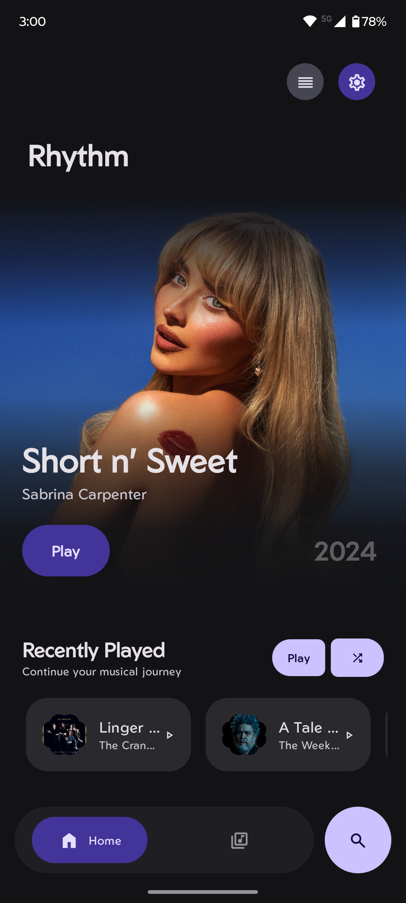
 <b>🏠 Inicio</b>
</td>
<td align="center" width="25%">
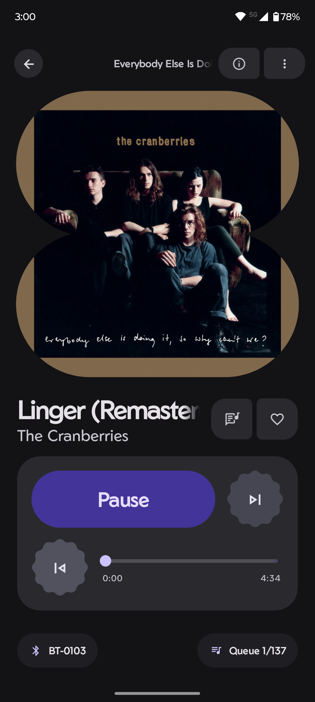
 <b>▶️ Reproductor</b>
</td>
<td align="center" width="25%">
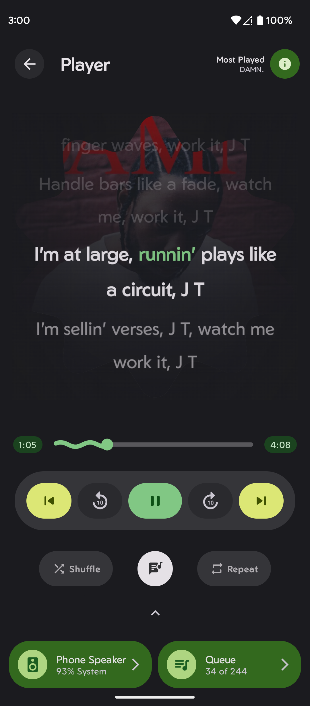
 <b>🎤 Letras</b>
</td>
<td align="center" width="25%">
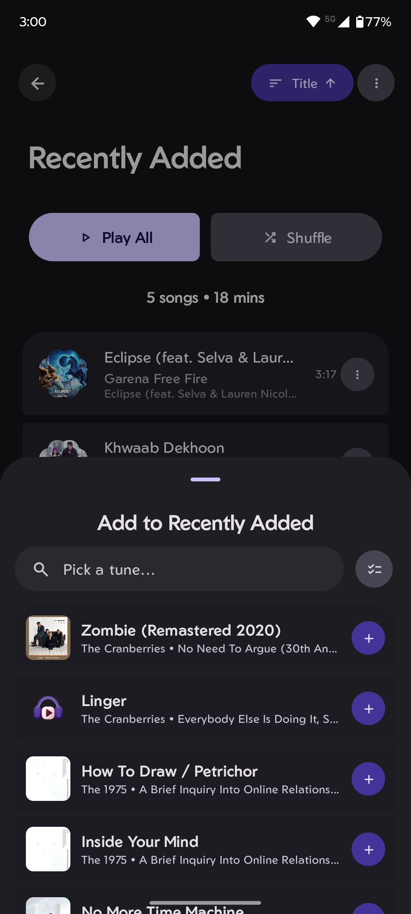
 <b>📚 Biblioteca</b>
</td>
</tr>
<tr>
<td align="center">
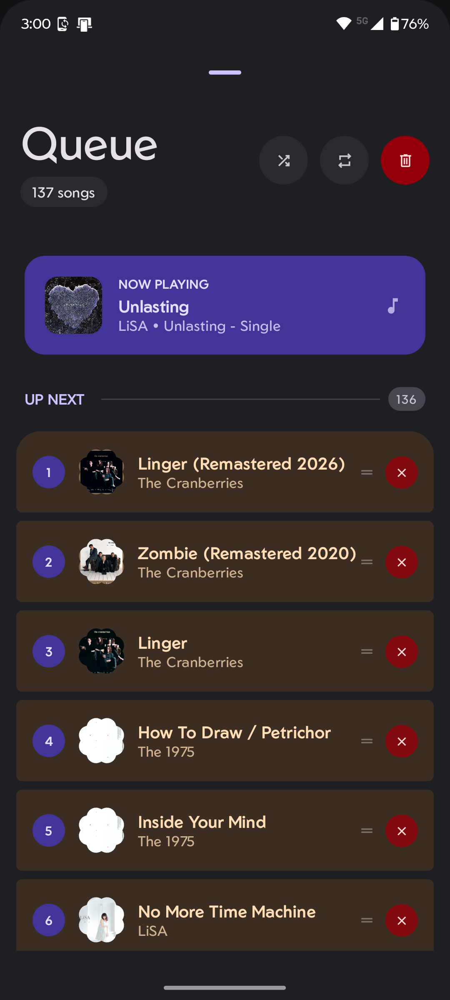
 <b>📋 Cola</b>
</td>
<td align="center">
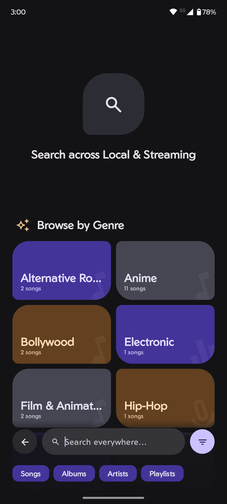
 <b>🔍 Búsqueda</b>
</td>
<td align="center">
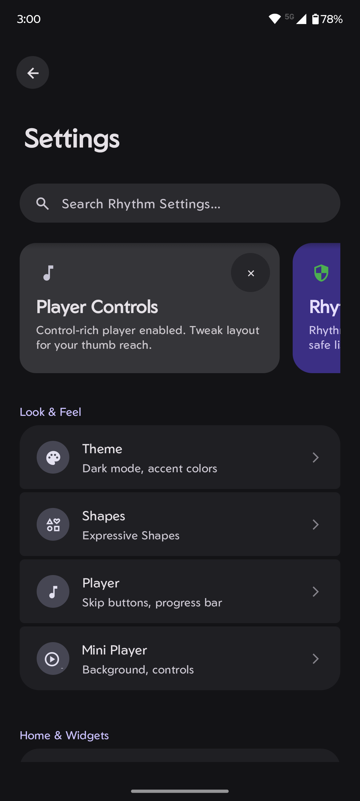
 <b>⚙️ Ajustes</b>
</td>
<td align="center">
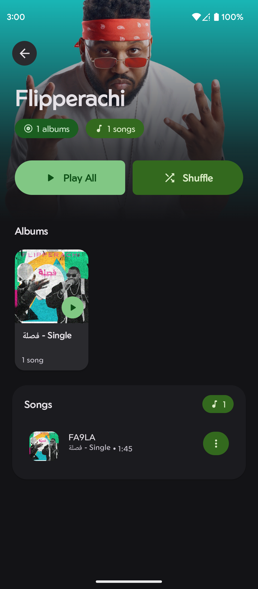
 <b>🎤 Artistas</b>
</td>
</tr>
</table>

### Tablet

<table>
<tr>
<td align="center" width="25%">
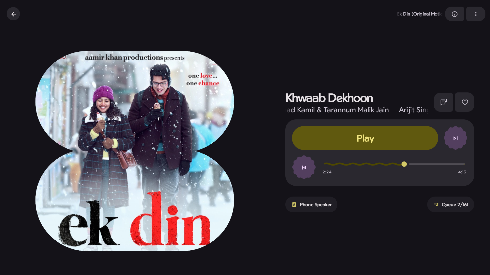
 <b>▶️ Reproductor</b>
</td>
<td align="center" width="25%">
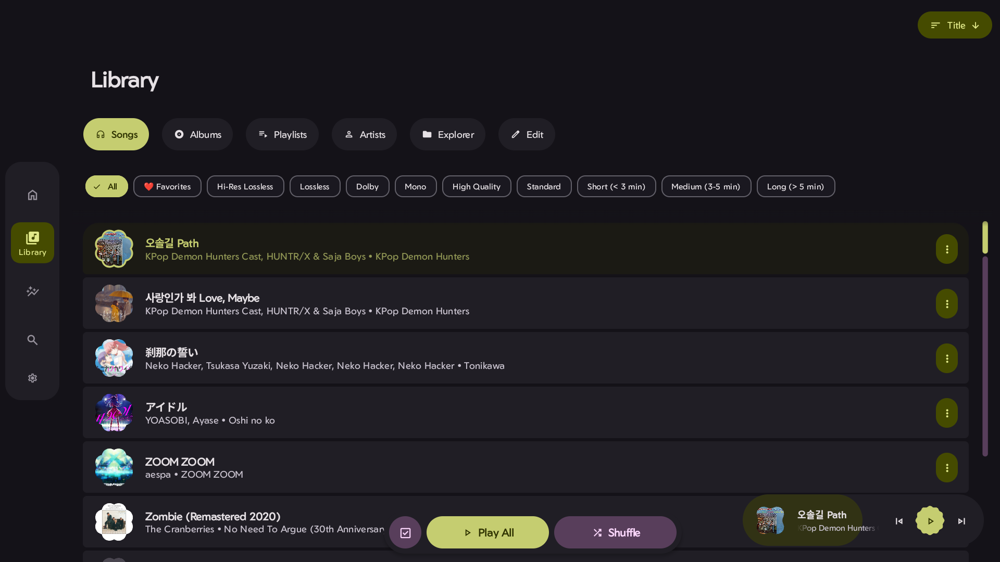
 <b>📚 Biblioteca</b>
</td>
<td align="center" width="25%">
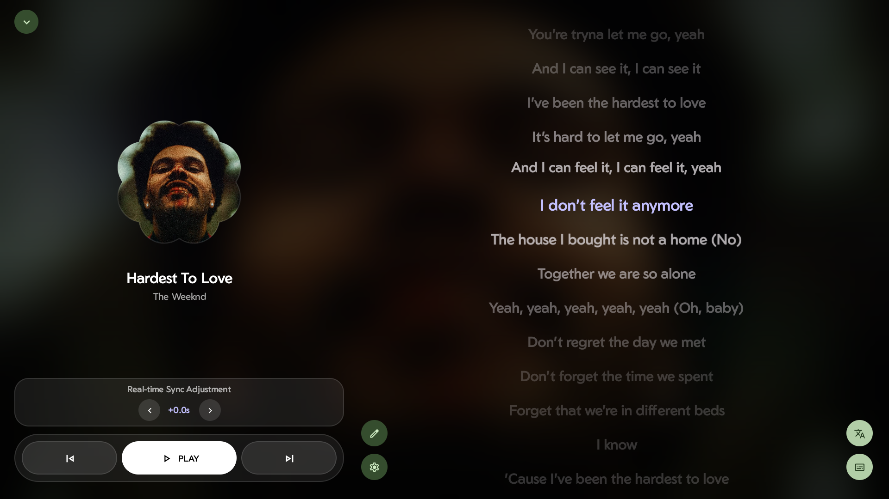
 <b>🎤 Letras</b>
</td>
<td align="center" width="25%">
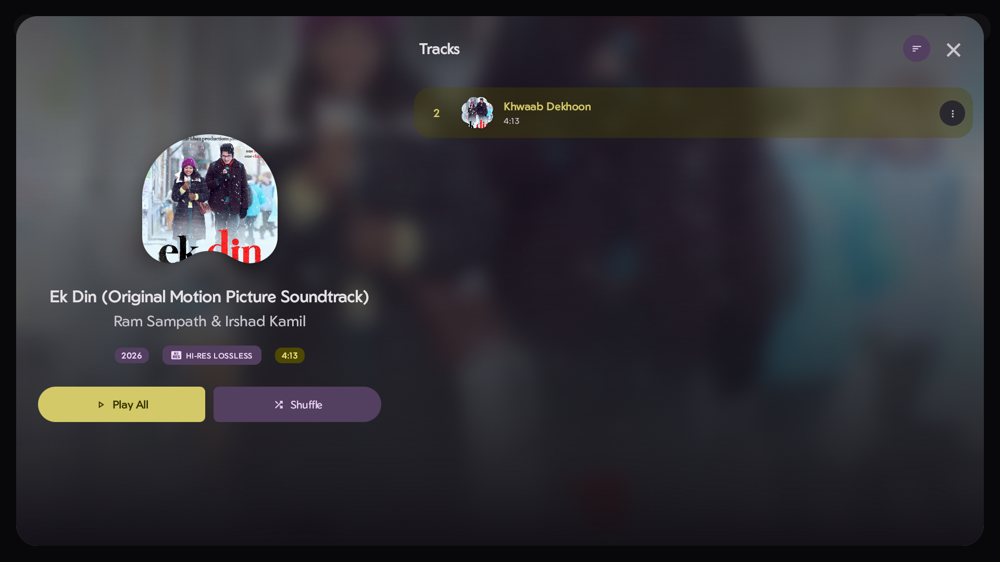
 <b>💿 Álbum</b>
</td>
</tr>
<tr>
<td align="center">
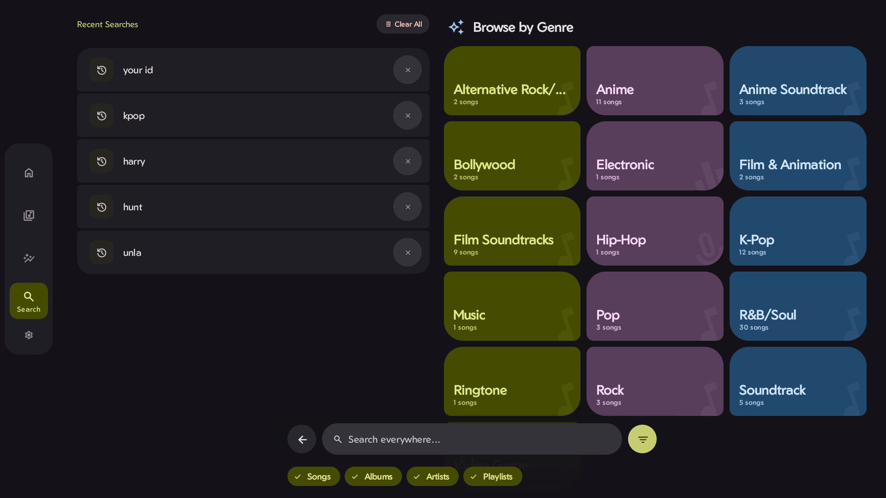
 <b>🔍 Búsqueda</b>
</td>
<td align="center">
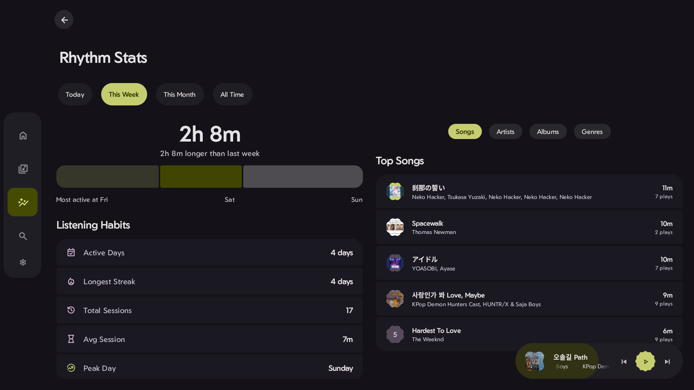
 <b>📊 Estadísticas</b>
</td>
<td align="center">
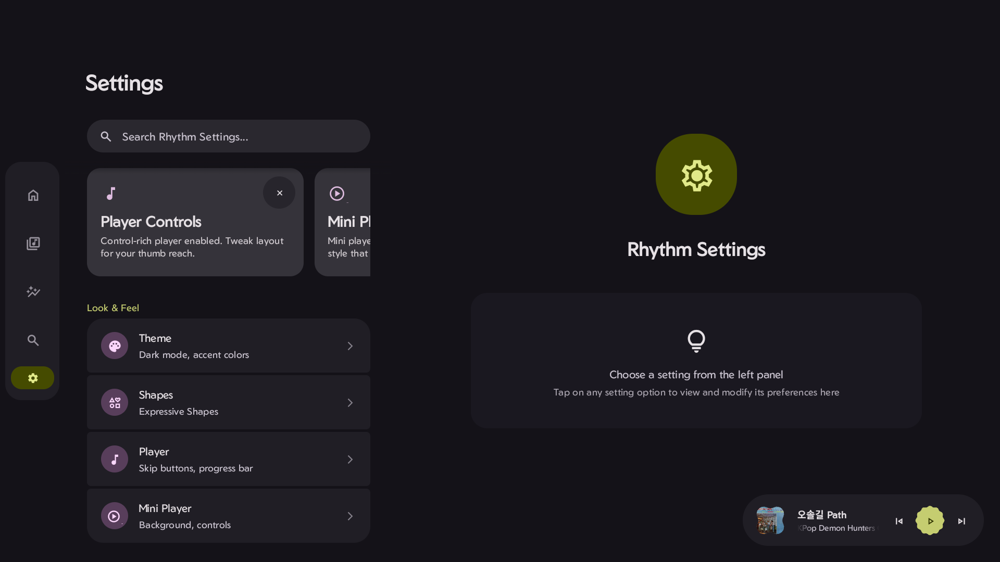
 <b>⚙️ Ajustes</b>
</td>
<td align="center">
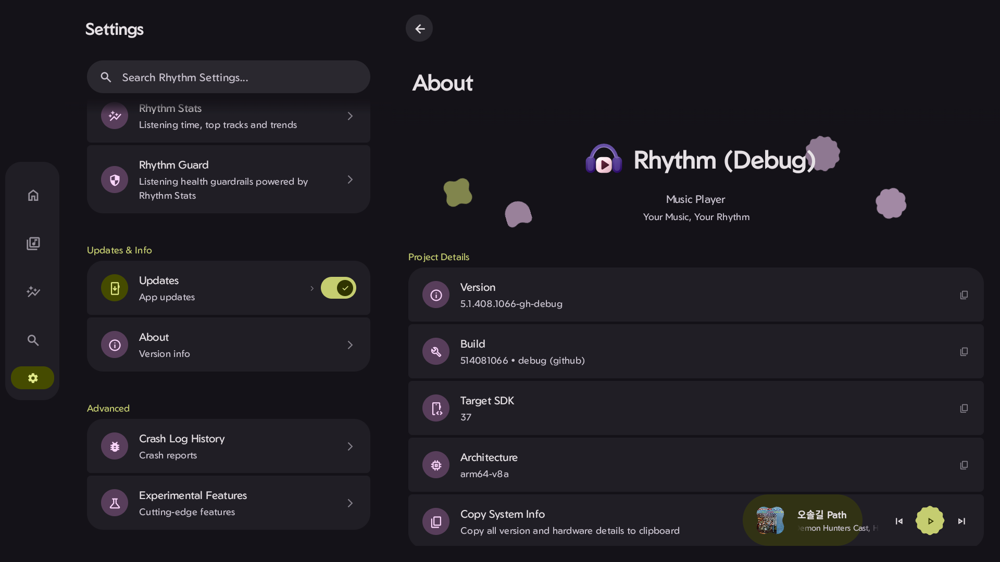
 <b>ℹ️ Acerca de</b>
</td>
</tr>
</table>

---

## 📥 Descarga e instalación

| Fuente | Descripción |
| :--- | :--- |
| **GitHub** | [APK firmado de la última versión](https://github.com/angel-ssk/Melo/releases/latest). Incluye el flavor `github` con actualizaciones integradas. |
| **F-Droid / IzzyOnDroid** | Variante `fdroid` del mismo proyecto, sin dependencias de servicios propietarios. |

Si instalas desde el APK, habilita “Instalar aplicaciones desconocidas” para la fuente. La app se actualiza desde los releases de este repositorio.

> Consulta [Build Variants](docs/BUILD_VARIANTS.md) y las [instrucciones de compilación](https://github.com/angel-ssk/Melo/wiki/Build-Instructions) para más detalles.

---

## 🛠 Tecnología

* **Interfaz:** Jetpack Compose, Material 3 Expressive, Glance Widgets, Coil.
* **Audio:** Media3 ExoPlayer, motor de crossfade de dos players, ecualizador y Replay Gain.
* **Arquitectura:** MVVM + Clean Architecture, Kotlin, Coroutines + Flow.
* **Datos:** Room + SQLite, DataStore, Gson.
* **Rendimiento:** cachés adaptativas, arranque diferido, baseline profile y macrobenchmarks de gama baja.

---

## 🌍 Idiomas

* **Español:** completo (2944/2944 cadenas).
* **Inglés:** idioma base.
* **Otros idiomas:** disponibles en el árbol de recursos del proyecto.

---

## 🤝 Contribuir

* 🐛 ¿Encontraste un error? [Abre un issue](https://github.com/angel-ssk/Melo/issues).
* 💡 ¿Tienes una idea? [Propón una función](https://github.com/angel-ssk/Melo/issues).
* 📖 ¿Necesitas ayuda? Lee la [Wiki](https://github.com/angel-ssk/Melo/wiki).

---

## 🏆 Créditos

**Mantenedor:** [Angel (@angel-ssk)](https://github.com/angel-ssk)

**Crédito original:** proyecto derivado del trabajo de Anjishnu Nandi. Se conservan los avisos SPDX originales según exige la licencia GPL-3.0-or-later.

Gracias también al equipo de Material Design de Google, AOSP, JetBrains y a la comunidad de software libre.

---

### ✨ Hecho con ❤️ para quienes escuchan su propia música

**Licencia:** [GNU General Public License v3.0](docs/LICENSE) 
© 2026 Angel. Todos los derechos reservados. 
⭐ Si Melo mejora tu escucha diaria, no olvides darle una estrella al repositorio. ⭐

